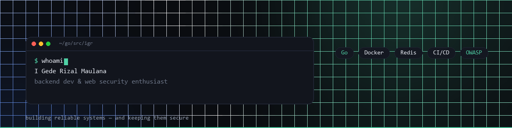

  

### Hi, I'm I Gede Rizal Maulana 👋

**Backend developer from Bali — I build reliable systems, then make sure they stay secure.**

---

## What I do

- **Backend** — REST APIs in Go, Redis caching, HTTP internals
- **DevOps** — Docker, GitHub Actions CI/CD, Prometheus & Grafana, Linux servers
- **Security** — OWASP Top 10, security code review, server hardening, SSRF & cache poisoning

## Featured work

### CDN Simulator

Multi-region CDN written in Go: 3 containerized edge servers, latency-based L7 router, origin server, and Redis cache — with stale-while-revalidate, tag/pattern invalidation, Prometheus metrics, Grafana dashboards, and a CI pipeline that runs unit tests plus a live MISS → HIT smoke test on every push.

**Self-audited against OWASP:** 11 findings (4 high severity — unauthenticated admin API, SSRF, exposed Redis & Grafana), all fixed and locked in with regression tests in CI.

### PhotoSelect

Password-protected photo & document vault. Supabase auth + row-level security, resumable uploads, image processing, and full project documentation (proposal, serah-terima, SQL schema).

## Tooling

| Backend | DevOps | Security | Frontend |
|:-------:|:------:|:--------:|:--------:|
|    |     |    |    |

## Currently

- 🔭 Studying **web application security** on PortSwigger Web Security Academy (SQLi, XSS, SSRF, IDOR)
- 🛠️ Building **backend services in Go** with observability baked in
- 💬 Open to **freelance backend / DevOps / security audit** work — remote, worldwide

## Stats

  

---

  Built from scratch — no template. <a href="https://igederizal.github.io">igederizal.github.io</a>

